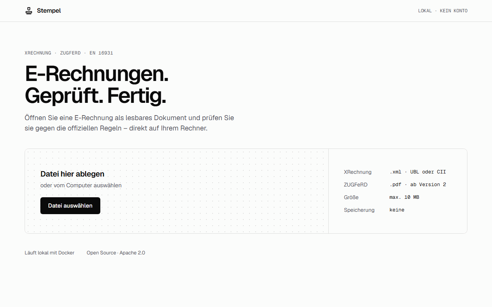
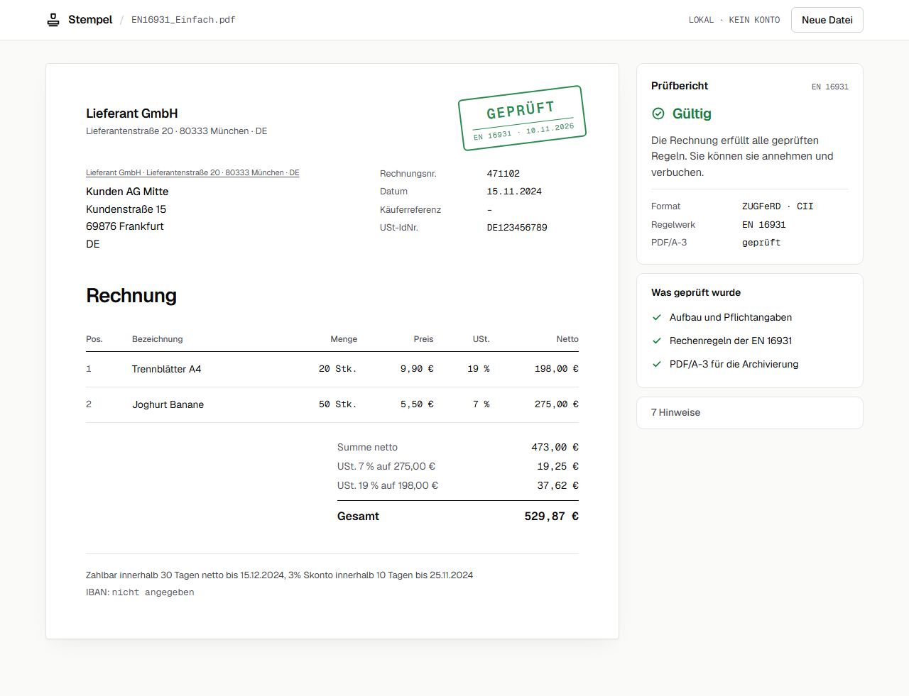
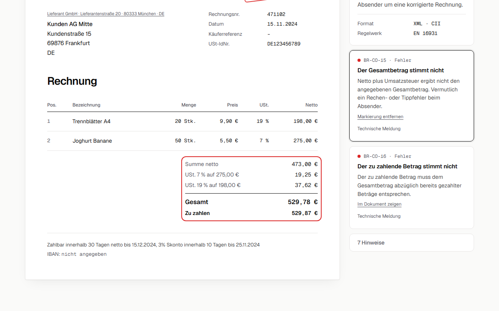

# Stempel

[](https://github.com/arberzyba/stempel/actions/workflows/ci.yml)

**E-Rechnungen. Geprüft. Fertig.**

Stempel is a self-hosted web app for German small businesses to open and check e-invoices. Drop in an XRechnung (XML) or ZUGFeRD (PDF) file, and Stempel shows it as a readable invoice and checks it against the official rules, with every problem explained in plain German. It runs on your own machine with Docker, needs no account and stores nothing.



Why: in Germany, every business must be able to receive e-invoices since 1 January 2025, and issuing them becomes mandatory in 2027 and 2028. Many small businesses can't even open these files.

## Features

- **Viewer:** shows the invoice laid out like a German business letter (DIN 5008): seller, buyer, line items, VAT per rate, totals and payment details. Amounts are shown exactly as the invoice states them.
- **Validator:** checks against EN 16931, XRechnung 3.0 and, for ZUGFeRD, the PDF/A-3 archive format. Errors, warnings and notices are listed separately, each with a German explanation and the original rule text. Clicking an error highlights the matching part of the invoice.
- **Formats:** XRechnung in both syntaxes (UBL and UN/CEFACT CII) and ZUGFeRD 2.x / Factur-X PDFs.
- **Private by design:** files are processed in memory and never written to disk, not even as temp files. The containers run read-only, and the app loads nothing from third parties (fonts are bundled).

| A valid ZUGFeRD invoice | An invoice with a wrong total |
|---|---|
|  |  |

## Run it

You need [Docker](https://www.docker.com/products/docker-desktop/). Then:

```sh
git clone https://github.com/arberzyba/stempel.git
cd stempel
docker compose up --build
```

Open http://localhost:8080. Stempel is only reachable from your own computer; the comment in `docker-compose.yml` shows how to open it to your network.

No e-invoice at hand? Try `backend/src/test/resources/samples/EN16931_Einfach.pdf` (valid) and `docs/demo/rechnung-mit-fehler.xml` (wrong total).

## What happens to your file

1. The browser sends the file to the Stempel backend on your machine.
2. The backend reads it with [Mustang](https://www.mustangproject.org/) and checks it against the official Schematron rules, all in memory.
3. The answer goes back to the browser, and the file is gone. File contents are never logged, and nginx keeps no access log (no IP addresses). For unreadable files, the backend logs only the type of error.

## Limitations

- The rule sets come from Mustang 2.26.0 (EN 16931, XRechnung 3.0). For a legally binding check, the official [KoSIT validator](https://github.com/itplr-kosit/validator) is the reference.
- XRechnung Extension and XRechnung CVD are only partly supported; Stempel says so in the report.
- About 40 common rules have a German explanation; for all others, Stempel shows the official rule text.
- Stempel views and checks invoices. Creating them is planned for version 2.

## How it's tested

- 131 backend tests (JUnit), including every one of the 86 invoices in the official [KoSIT XRechnung test suite](https://github.com/itplr-kosit/xrechnung-testsuite), broken invoices, a non-invoice PDF and XXE attacks.
- 15 frontend tests (Vitest, Testing Library) for formatting and the full upload flow.
- GitHub Actions runs everything on each push, then builds the Docker images and uploads real invoices to the running containers.

Running the official test suite showed that real invoices with legal one-cent rounding differences couldn't be opened, and that a recalculated total was shown instead of the stated one. Both are fixed and covered by tests.

## Architecture

```
Browser ──▶ nginx (frontend container) ──/api──▶ Spring Boot (backend container) ──▶ Mustang
            serves the React app                  /api/invoices/view      → InvoiceView (JSON)
            security headers (CSP)                /api/invoices/validate  → ValidationReport (JSON)
```

| Part | Technology |
|---|---|
| Backend | Java 21, Spring Boot 4, Mustang (reading and Schematron/PDF-A checks) |
| Frontend | React 19, TypeScript, Vite |
| Delivery | Docker (multi-stage builds), Docker Compose, GitHub Actions |

Some decisions:

- **Mustang's validator instead of the KoSIT validator:** it bundles the official XRechnung 3.0 and EN 16931 rules plus PDF/A checks in one Java library, and correctly treats XRechnung rules as notices for plain ZUGFeRD invoices.
- **Stated amounts over recalculated ones:** a viewer must show what the invoice says. Whether it adds up is the validator's job.
- **No database in version 1:** nothing to store means nothing to leak.

## Development

```sh
# Backend (http://localhost:8080)
cd backend
./mvnw spring-boot:run
./mvnw test                          # tests
sh scripts/fetch-kosit-testsuite.sh  # optional: also run the full KoSIT test suite

# Frontend (http://localhost:5173, forwards /api to the backend)
cd frontend
npm install
npm run dev
npm test
npm run lint

# README screenshots and GIF (needs the app running via docker compose)
npx playwright install chromium   # once
npm run docs:capture
```

## License

[Apache 2.0](LICENSE). The sample invoices in `backend/src/test/resources/samples` come from the KoSIT test suite and the Mustang project, both Apache 2.0 (see the [samples README](backend/src/test/resources/samples/README.md)).
